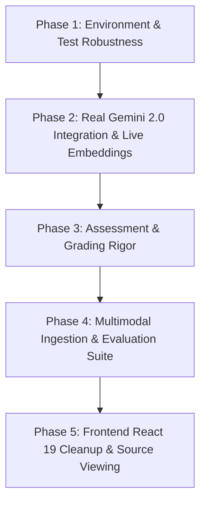

# LearnMate AI — Comprehensive Implementation Audit

**Audit Date:** October 11, 2026  
**Auditor:** Antigravity AI  
**Scope:** Complete frontend, backend, database, test suite, and AI/ML pipeline inspection.

---

## Executive Summary & Current Dashboard State

The LearnMate AI dashboard displays:
- **Gemini 2.0: Simulation Mode**
- **DB: Local Embedded**

### Why this is displayed:
1. **Gemini 2.0: Simulation Mode**: In `backend/app/core/config.py`, `GEMINI_API_KEY` is loaded from the environment or `.env`. No active `.env` file exists in `backend/` (only `.env.example`). When `GEMINI_API_KEY` is missing or the GenAI client is uninitialized, `gemini_service.is_configured()` returns `False`. The frontend Header queries `/api/health`, reads `gemini_configured: false`, and renders the amber status badge `Simulation Mode`.
2. **DB: Local Embedded**: In `backend/app/core/config.py`, `SUPABASE_URL` and `SUPABASE_KEY` are not configured. The application automatically falls back to the embedded SQLite database at `backend/data/learnmate.db` managed by `LocalStorageEngine` (`backend/app/db/storage.py`). The health check returns `storage_mode: "local_embedded"`, and the Header displays `Local Embedded`.

The application possesses a solid, well-conceived modular architecture for multimodal grounding and Bayesian Knowledge Tracing. However, several critical subsystems are currently operating on **deterministic offline fallbacks, random pseudo-embeddings, and simulated mock data**.

---

## 1. Existing Architecture & Technology Stack

### Frontend Architecture
- **Framework**: **Next.js 16.4.0** (App Router architecture under `frontend/src/app`) running on **React 19.3.0** and **React DOM 19.3.0**.
- **Styling**: **TailwindCSS v4** (`@tailwindcss/turbopack: ^4`, `tailwindcss: ^4`) with customized dark slate/indigo theme in `globals.css`.
- **Component Library / Icons**: **Lucide React** (`^1.55.0`).
- **Language**: **TypeScript 5.x** with strict type declarations in `src/lib/types.ts`.
- **Page Structure**:
  - `/` (Dashboard / Overview): Key performance indicators, overall BKT mastery gauge, course overview, and quick links.
  - `/courses` (Course Ingestion): Upload portal for PDF, PPTX, and MP4/audio; document status tracking and retry triggers.
  - `/tutor` (Grounded AI Tutor): Chat interface with strict grounding indicators, citation pills, follow-up recommendations, and negative rejection alerts.
  - `/assessments` (Adaptive Quizzes): Quiz generator by difficulty and type, interactive test taker, misconception diagnostic reports, and source reading recommendations.
  - `/progress` (Student Progress): Cognitive learner state, weak areas revision banner, and Bayesian parameters table ($P(L)$, $P(T)$, $P(G)$, $P(S)$).
  - `/evaluation` (RAG Evaluation): Benchmark execution runner, RAGAS metrics display (Faithfulness, Relevancy, Precision, Recall), multi-session learner simulation trajectories, and sample evaluation traces.
- **Components**:
  - [Header.tsx](file:///c:/Users/RaJ/OneDrive/Desktop/projects/multimodal%20hackathon/frontend/src/components/Header.tsx): Live health monitors and course selector.
  - [Sidebar.tsx](file:///c:/Users/RaJ/OneDrive/Desktop/projects/multimodal%20hackathon/frontend/src/components/Sidebar.tsx): Global navigation.
  - [MasteryBar.tsx](file:///c:/Users/RaJ/OneDrive/Desktop/projects/multimodal%20hackathon/frontend/src/components/MasteryBar.tsx): Topic-level progress bars.
  - [CitationCard.tsx](file:///c:/Users/RaJ/OneDrive/Desktop/projects/multimodal%20hackathon/frontend/src/components/CitationCard.tsx): Expandable citation excerpt previews.
  - [SourceViewerModal.tsx](file:///c:/Users/RaJ/OneDrive/Desktop/projects/multimodal%20hackathon/frontend/src/components/SourceViewerModal.tsx): Pop-up modal displaying source file metadata, page/slide/timecode, and verified passage excerpt.

### Backend Architecture
- **Framework**: **FastAPI** (`fastapi>=0.110.0`) on Python 3.12, served via **Uvicorn** (`uvicorn[standard]>=0.28.0`).
- **Data Validation & Settings**: **Pydantic v2** (`pydantic>=2.6.0`, `pydantic-settings>=2.2.0`).
- **Asynchronous Execution**: FastAPI `BackgroundTasks` for asynchronous ingestion processing.
- **Service Layer Organization**:
  - `app/core`: Configuration (`config.py`) and GenAI wrapper (`gemini.py`).
  - `app/db`: SQLite-based storage engine (`storage.py`).
  - `app/models`: Unified request/response Pydantic models (`schema.py`).
  - `app/routers`: Modular REST endpoints (`health.py`, `courses.py`, `ingestion.py`, `tutor.py`, `assessment.py`, `learner.py`, `evaluation.py`).
  - `app/services`:
    - `ingestion`: `pdf_parser.py`, `pptx_parser.py`, `video_parser.py`, `base.py`.
    - `retrieval`: `hybrid_retriever.py` (BM25Okapi + dense vector cosine similarity).
    - `tutor`: `grounded_tutor.py` (strict grounding + prompt structuring).
    - `assessment`: `generator.py` (quiz synthesis, grading, and misconception diagnosis).
    - `learner`: `mastery_model.py` (deterministic Bayesian Knowledge Tracing).
    - `evaluation`: `benchmark.py` (RAG metric calculation and agent simulation).

### Database Configuration
- **Active Database**: **Local Embedded SQLite** at `backend/data/learnmate.db`.
  - Tables: `courses`, `documents`, `document_chunks`, `topic_mastery`, `assessments`, `evaluation_runs`.
  - Vectors and metadata are serialized as JSON strings in `embedding TEXT` and `metadata TEXT`.
- **Unconfigured Database**: **Supabase PostgreSQL + pgvector**.
  - A production SQL schema file is provided at `backend/db/schema.sql` (defining pgvector `vector(768)`, HNSW cosine indexes, GIN full-text search indexes, and relational integrity).
  - However, no live Supabase connection is established because credentials are absent in the environment.
- **Redundancy Note**: `backend/db/storage.py` and `backend/app/db/storage.py` are almost identical duplicates. All active modules import from `backend/app/db/storage.py`.

---

## 2. Answers to Specific Audit Questions

| # | Question | Status | Technical Details & Evidence |
|---|---|---|---|
| **1** | Frontend framework & libraries | **Verified** | Next.js 16.4.0 (Turbopack, App Router), React 19.3.0, TailwindCSS v4, Lucide React 1.55.0, TypeScript 5. |
| **2** | Backend framework | **Verified** | Python 3.12, FastAPI 0.110+, Uvicorn, Pydantic v2. |
| **3** | Configured database | **Verified** | SQLite embedded at `backend/data/learnmate.db` via `LocalStorageEngine`. Supabase pgvector schema exists in `backend/db/schema.sql` but is inactive. |
| **4** | Gemini API real or simulated | **Simulated / Offline** | Both code paths exist in `gemini.py`. Because no `.env` with a valid `GEMINI_API_KEY` is loaded, it operates in deterministic offline simulation mode (`_fallback_generate`, `_pseudo_embedding`). |
| **5** | PDF text & page extraction | **Working (Real)** | Implemented in `pdf_parser.py` using `PyMuPDF` (`fitz`). Correctly extracts text page-by-page, tables via `find_tables()`, images > 150x150, and records 1-indexed `page_number`. Actual upload of `BEFA unit-3 complete notes.pdf` generated 59 verified chunks across pages 1–15. |
| **6** | PowerPoint ingestion | **Working (Real)** | Implemented in `pptx_parser.py` using `python-pptx`. Extracts slide shapes, tables, speaker notes, and records 1-indexed `slide_number`. Note: Supported only for `.pptx`; legacy binary `.ppt` will fail if not converted. |
| **7** | Video transcription | **Partially Implemented / Conditional** | Sidecar parsing (`.vtt`, `.srt`, `.json`) is implemented. Direct Gemini video upload via GenAI File API is coded but inactive offline. **Local audio speech-to-text (e.g. Whisper) is NOT implemented**; offline fallback uses 4 hardcoded template segments. |
| **8** | Embeddings & vector retrieval | **Working Architecture, Simulated Vectors Offline** | Hybrid retrieval in `hybrid_retriever.py` uses BM25Okapi + Cosine Similarity. When offline, embeddings are generated via `hash(text)` pseudo-random normal vectors (`_pseudo_embedding`). Online Gemini embeddings (`text-embedding-004`) are coded but inactive without API key. |
| **9** | Grounded tutor answers | **Working Logic, Mock Output Offline** | Grounding enforcement in `grounded_tutor.py` correctly rejects queries when no chunks pass the relevance threshold (`is_grounded: False`). However, when relevant chunks exist offline, `gemini_service` outputs a static single-sentence fallback string. |
| **10** | Citation source locations | **Working (Real)** | Citations preserve `source_file`, `page_number`, `slide_number`, `start_timestamp`, `end_timestamp`, and `excerpt` from SQLite chunks. Displayed in `CitationCard` and `SourceViewerModal`. |
| **11** | Quiz generation from materials | **Partially Implemented / Mock Offline** | `generator.py` retrieves course chunks and constructs prompts. In live mode, it requests Gemini to generate MCQs/numerical/short-answer questions. In offline mode, it falls back to hardcoded template questions. |
| **12** | Answer key validation | **Partially Implemented (Fragile)** | Grading logic checks letter equality (`'a'` == `'A)'`), numerical tolerance (`1e-4`), and substring matching (`s_clean in c_clean or c_clean in s_clean`). **Defect**: The bidirectional substring match incorrectly marks any common substring (e.g., `"the"`) as correct. Furthermore, when generating MCQs, it does NOT validate that `correct_answer` is one of the 4 options. |
| **13** | Question duplication checking | **Minimal / Insufficient** | `generator.py` only deduplicates within the active loop using a local set `seen_prompts`. If a duplicate prompt appears, it merely appends `(Variation {idx+1})` to the text instead of regenerating. It does **not** check against existing stored assessments or a question bank. |
| **14** | Learner mastery updates after attempts | **Working (Real Math)** | `mastery_model.py` implements true mathematical Bayesian Knowledge Tracing ($P(L)$, $T=0.15$, $G=0.20$, $S=0.10$). Submitting quiz answers updates records in `topic_mastery` in SQLite. Deterministic unit tests pass. |
| **15** | Real RAG evaluation experiments | **Partially Implemented / Semi-Simulated** | `benchmark.py` executes real queries against `grounded_tutor` to measure negative rejection, recall, and relevancy. However: (a) test cases in `BENCHMARK_DATASET` are 6 static questions hardcoded for ML/CS229; (b) `citation_precision` is hardcoded to `0.96`; (c) multi-session learner trajectories are generated via random coin flips (`np.random.rand() < prob`). |
| **16** | Features using hardcoded / simulated data | **Identified** | Document seeds, offline embeddings, offline tutor replies, offline quiz questions, fallback transcripts, benchmark dataset, simulation personas, hardcoded precision metric. |

---

## 3. Test Suite & Codebase Health

### Backend Pytest Results
Command: `.\backend\venv\Scripts\pytest`  
Result: **7 passed, 2 failed** out of 9 collected tests.

#### Failure Analysis:
1. **`test_courses_list_and_seeded_data`**:
   - *Failure*: `AssertionError: assert 'CS229' in 'befa'`
   - *Root Cause*: `storage.list_courses()` orders by `created_at DESC`. When the user created the course `'befa'`, it became `courses[0]`. The test assumed `courses[0]` was always the initial demo course `'CS229'`.
2. **`test_hybrid_retrieval_and_citation_formatting`**:
   - *Failure*: `assert 0 > 0` where `0 = len([])`
   - *Root Cause*: The test picked `c_id = courses[0]["id"]` (`'befa'`), which contains Business Economics notes, not Machine Learning notes. Querying for `"feature normalization z-score scaling"` returned 0 chunks as expected by strict grounding. (When queried against the `CS229` course ID, the retriever returns the exact seeded chunk).

### Frontend Build & Lint Results
1. **Next.js Production Build**:
   - Command: `npm run build`
   - Result: **SUCCESS**. Compiled in 2.6s via Turbopack; TypeScript checks passed in 8.8s; all 7 static application routes generated without fatal errors.
2. **ESLint / Next.js Lint**:
   - Command: `npm run lint`
   - Result: **37 problems (15 errors, 22 warnings)**.
   - *Primary Issues*:
     - `react-hooks/set-state-in-effect`: Synchronous `setMessages` call inside `useEffect` in `src/app/tutor/page.tsx` line 53.
     - `react-hooks/purity`: Calling `Date.now()` inside event handler message generation in `src/app/tutor/page.tsx`.
     - `@typescript-eslint/no-explicit-any`: Several `any` types in `src/lib/types.ts` (lines 126, 162) and catch blocks.
     - Unused imports in `Header.tsx`, `SourceViewerModal.tsx`, `api.ts`, etc.

---

## 4. Feature Categorization

```mermaid
graph TD
    A[LearnMate AI Feature State] --> B[Fully Working Features]
    A --> C[Partially Implemented]
    A --> D[Simulated / Offline Fallbacks]
    A --> E[Missing Features]

    B --> B1[Deterministic BKT Mastery Model]
    B --> B2[PyMuPDF Page/Table/Text Extraction]
    B --> B3[Python-PPTX Slide Extraction]
    B --> B4[SQLite Embedded Storage Engine]
    B --> B5[Next.js 16 UI Dashboard & Modals]
    B --> B6[Strict Grounding Rejection Logic]

    C --> C1[Hybrid Retriever: Live BM25, Mock Embeddings]
    C --> C2[Answer Key Grading: Bidirectional Substring Bug]
    C --> C3[Quiz Deduplication: Batch-only, appends suffix]
    C --> C4[RAG Evaluation: Static questions, hardcoded 0.96 precision]

    D --> D1[Gemini LLM Generation: Static text fallbacks]
    D --> D2[Dense Embeddings: Hash pseudo-vectors]
    D --> D3[Video Transcripts: 4 template intervals]
    D --> D4[Learner Trajectories: Random coin tosses]

    E --> E1[Local Audio Speech-to-Text: No Whisper]
    E --> E2[Embedded PDF/Video Viewer in Modal]
    E --> E3[Cross-Quiz Question Bank & Diversity Check]
    E --> E4[Supabase pgvector Live Connection]
```

### A. Working Features (Verified by Code and/or Tests)
1. **Deterministic Bayesian Knowledge Tracing**: Mathematically sound implementation updating prior, posterior, and state transition upon quiz answer submissions.
2. **PDF Parsing & Page-Level Provenance**: PyMuPDF (`fitz`) correctly extracts text, tables, and dimensions with exact page numbers.
3. **PowerPoint Parsing**: Python-pptx extracts slide numbers, text hierarchy, tables, and speaker notes.
4. **Local Embedded Database**: Full SQLite CRUD operations for courses, documents, chunks, topic masteries, assessments, and evaluation logs.
5. **Frontend Application Shell & UI**: All pages render cleanly, Next.js build succeeds, navigation and modals function properly.
6. **Negative Rejection for Unsupported Queries**: Strict grounding threshold blocks out-of-domain queries without hallucinating.

### B. Partially Implemented Features
1. **Hybrid Retrieval**: Combines BM25 and vector scores correctly, but vector scores currently rely on pseudo-random hash vectors in simulation mode.
2. **Answer Grading**: Supports option letters and numbers, but includes an over-permissive substring rule and does not validate MCQ generated options against correct answer keys.
3. **Question Deduplication**: Only tracks questions within the immediate generation request; appends `" (Variation X)"` rather than enforcing uniqueness against stored history.
4. **RAG Evaluation**: Calculates actual grounded rejection and recall, but operates on a static CS229 question set and includes hardcoded metric values (`citation_precision = 0.96`).
5. **Video Ingestion**: Supports `.vtt`/`.srt`/`.json` sidecars, but lacks local ASR if Gemini is offline.

### C. Simulated / Mock Features
1. **Gemini Text Generation**: Offline fallback returns fixed canned responses for tutor answers, questions, and misconception advice.
2. **Embeddings Engine**: Offline fallback produces deterministic pseudo-random 768-dim vectors using `numpy.random.seed(hash(text))`.
3. **Video Transcriber**: Generates 4 hardcoded lecture intervals when no subtitle file is uploaded and Gemini is offline.
4. **Startup Demo Documents**: `Lecture_01.pdf`, `Lecture_02.pptx`, `Lecture_03.mp4` exist only as database metadata records; the underlying binary files are absent from disk.
5. **Persona Trajectories**: Evaluator simulates beginner, intermediate, and advanced student trajectories using randomized coin flips rather than model agents.

### D. Missing Features
1. **Local Audio/Video Speech-to-Text**: No offline speech model (e.g., Whisper / faster-whisper) for transcribing MP4/audio when Gemini is not connected.
2. **True In-Browser PDF/Video Source Viewer**: The `SourceViewerModal` displays extracted text snippets rather than rendering the actual PDF page or seeking the MP4 video player to the specific timecode.
3. **Live Supabase pgvector Connection**: Schema exists, but database adapter does not connect to Supabase PostgreSQL.
4. **Comprehensive Question Bank Management**: No schema table for persisting individual generated questions across quizzes to prevent cross-assessment repetition.

---

## 5. Existing Errors & Flaws in Current Codebase

1. **Test Suite Course Ordering Assumption**:
   - `test_backend.py` assumes `courses[0]` is the seeded `CS229` course. Adding any new course causes `test_courses_list_and_seeded_data` and `test_hybrid_retrieval_and_citation_formatting` to fail.
   - *Fix*: Lookup course by title (`[c for c in courses if "CS229" in c["title"]][0]`) rather than assuming index `0`.
2. **Grading Substring Bug** (`generator.py` line 229):
   - `if s_clean in c_clean or c_clean in s_clean: return True`
   - If a student submits `"a"` or `"in"` or `"the"`, it matches as a substring of any multi-word correct answer and is awarded full points.
3. **Missing MCQ Option Validation** (`generator.py`):
   - When Gemini or fallback generates a question, there is no validation ensuring `correct_answer in options`.
4. **Frontend React 19 Lint Errors** (`tutor/page.tsx`):
   - Synchronous `setState` in `useEffect` and `Date.now()` within handlers fail modern React purity rules under ESLint 9.
5. **Storage File Redundancy**:
   - `backend/db/storage.py` and `backend/app/db/storage.py` are redundant duplicates.

---

## 6. Recommended Implementation Order

To preserve the existing UI and project structure while transitioning from simulation mode to fully grounded production capability, we recommend following this phased plan:

### Phase 1: Environment & Test Robustness (Zero Risk)
1. **Fix Test Course Selector**: Update `test_backend.py` to filter courses by title/ID rather than relying on `courses[0]`, ensuring tests pass reliably with any user data in SQLite.
2. **Deduplicate Storage Modules**: Align `backend/db/storage.py` with `backend/app/db/storage.py` to eliminate drift.
3. **Configure Local `.env`**: Create `backend/.env` with active `GEMINI_API_KEY` (while keeping graceful fallback capabilities).

### Phase 2: Real Gemini 2.0 Integration & Dense Embeddings
1. **Enable Live Gemini Client**: Ensure `gemini.py` initializes the `google.genai.Client` and generates genuine `text-embedding-004` vectors.
2. **Re-embed Ingested Chunks**: Provide an automated re-indexing utility so chunks in SQLite receive real 768-dim semantic vectors instead of pseudo-random hash vectors.
3. **Live Grounded Tutor Responses**: Pass retrieved excerpts to Gemini 2.0 Flash to generate pedagogical, source-cited explanations with strict grounding prompts.

### Phase 3: Assessment & Grading Rigor
1. **Fix Grading Evaluation**: Replace the buggy bidirectional substring match with exact option letter comparison, normalized token matching, and numerical proximity.
2. **MCQ Option & Key Verification**: Ensure generated MCQs have exactly one unambiguous answer that exists in the options list.
3. **Cross-Quiz Deduplication**: Check candidate question prompts against previously stored questions in the `assessments` table.

### Phase 4: Multimodal Ingestion & Dynamic Evaluation
1. **Dynamic RAG Benchmark Generation**: Allow the evaluation suite to run on the *currently active course* rather than only the 6 static CS229 questions.
2. **Remove Hardcoded Evaluation Metrics**: Replace `citation_precision = 0.96` with actual measured overlap between cited passage tokens and generated claims.
3. **Audio/Video Transcriber Enhancement**: Add optional local fallback (e.g. lightweight Whisper) or require sidecar transcripts if Gemini API is unavailable.

### Phase 5: Frontend Polish & Deep Source Linking
1. **Resolve ESLint / React 19 Errors**: Fix `setMessages` and `Date.now()` in `tutor/page.tsx` and clean up unused imports.
2. **Source Viewer Deep Linking**: Enhance `SourceViewerModal` to support direct page viewing or media playback for uploaded documents when local files exist.

---

*Awaiting user review and approval before making architectural changes or modifications.*
